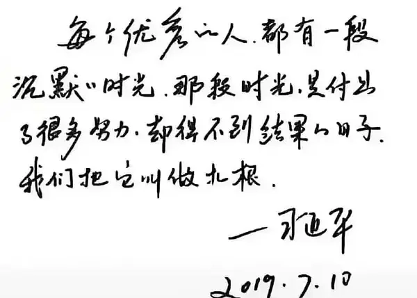

---
title: "扎根"
text: "一条待验证的摘录，附一张手写笔记；之后对照原文再定稿。"
source: "手写笔记 / 待校对"
tags: ["待验证"]
status: "待校对"
date: 2026-11-13
order: 3
---

  

**每个优秀的人，都有一段沉默的时光。那段时光，是付出了很多努力，却得不到结果的日子，我们把它叫做扎根。——习近平（2019.7.10）**