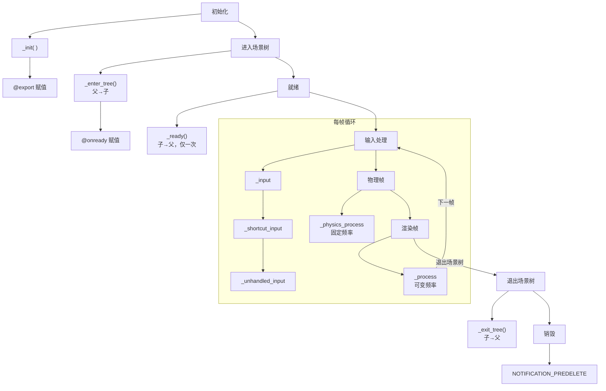

GDScript 的注解（`@` 开头）和生命周期回调，是控制节点**何时初始化、如何运行、以及何时销毁**的核心机制。理解它们，是写出行为可预测的 Godot 代码的关键。


## 注解

### `@export`：向编辑器“暴露”变量
它的作用是让变量出现在 Inspector（检查器） 面板中，方便你或设计师在不修改代码的情况下调整数值。Godot 会根据变量的类型自动显示合适的控件。

```gdscript
@export var speed: float = 300.0
@export var player_name: String = "Hero"
@export var color: Color = Color.WHITE
@export var enemy_scene: PackedScene
```

> 始终为导出变量添加类型注解，否则检查器可能无法显示正确的编辑控件。

`@export` 的常用变体：

- `@export_range`：为数值类型添加滑块和范围限制。参数为 (最小值, 最大值, 步长, 提示)，提示 "or_greater" 允许输入超过最大值的数。
    ```gdscript
    @export_range(0, 100) var health: int = 100
    @export_range(0.0, 1.0, 0.01) var volume: float = 0.8
    ```

- `@export_enum`：生成下拉菜单。配合 String 存储选项名称，配合 int 可指定具体数值。
    ```gdscript
    @export_enum("Warrior", "Mage", "Rogue") var character_class: String
    @export_enum("Easy:0", "Normal:1", "Hard:2") var difficulty: int = 1
    ```
- `@export_file` / `@export_dir`：分别生成文件和目录选择对话框。
    ```gdscript
    @export_file("*.tscn") var next_level_path: String
    @export_dir var save_directory: String
    ```
- `@export_group` / `@export_subgroup`：在 Inspector 中将导出变量折叠分组，让面板更整洁。

- `@export_multiline`	多行文本区域，适合对话、描述


### `@onready`：在“正确”的时机初始化引用
它的作用是让变量的赋值延迟到节点进入场景树、且所有子节点都准备好之后（即 `_ready()` 回调触发的前一刻）再进行。

典型用法是获取子节点引用：`@onready var sprite = $Sprite2D。`

为什么不能直接在 `_init()` 里用 `$Child` 获取子节点？ 因为在 `_init()` 执行时，节点还没有进入场景树，它的子节点尚不存在。`@onready` 完美解决了这个问题。

```gdscript
# 正确做法
@onready var health_bar: ProgressBar = $UI/HealthBar
@onready var player: CharacterBody2D = $Player

func _ready():
    # 此时 health_bar 和 player 已经被正确赋值
    health_bar.max_value = 100
```
`@onready` 与 `@export` 的优先级：如果一个变量同时使用了这两个注解，`@onready` 的赋值会覆盖 `@export` 在 Inspector 中设置的值。

> 注意：`@onready` 和 `@export` 同时用于同一个变量时行为可能不符合预期——`@onready` 的赋值发生在 `@export` 生效之后，会覆盖掉导出值。 

### `@tool`：让脚本在编辑器中运行
在脚本顶部使用 `@tool`，该脚本的逻辑（如 `_ready`、`_process`）就会在编辑器内也执行，常用于自定义编辑器插件或让场景在编辑时就有实时预览效果。

### `@rpc`
将函数标记为远程过程调用，用于多人游戏网络同步。默认模式为 "authority"和 "call_remote"。
```gdscript
@rpc("any_peer", "call_local", "reliable")
func sync_position(new_pos: Vector2):
    position = new_pos
```


## 可覆盖的生命周期回调
### 节点的生命周期
Godot 节点的生命周期遵循一个清晰的流程，每个阶段都有对应的可覆盖函数。
#### 阶段一：初始化
此阶段节点尚未进入场景树。

1. 成员变量初始化：脚本中的变量按声明顺序初始化。

2. `_init()`：相当于构造函数。此时节点还未进入场景树，不能安全地获取子节点或访问场景树相关功能。

3. `@export` 赋值：Inspector 中设置的值在此刻被应用。

#### 阶段二：进入场景树
当节点被添加到场景中时触发。

- `_enter_tree()`：节点刚刚进入场景树，此时它已经“存在”于树中，但子节点可能尚未完全就绪。父节点的 `_enter_tree` 先于其子节点执行。

- `@onready` 赋值：紧接着 `_enter_tree` 之后，但在 `_ready` 之前执行。

#### 阶段三：就绪
这是进行初始化逻辑最安全、最常用的地方。

- `_ready()`：只在节点一生中调用一次。此时节点自身及其所有子节点都已完全进入场景树，可以安全地访问任何子节点、设置属性或连接信号。

#### 阶段四：每帧处理
节点进入活跃状态后，会按不同的时间节奏被反复调用。

- `_process(delta)`：每一渲染帧调用一次。`delta` 是距上一帧的时间（秒）。适合处理与视觉/帧率相关的逻辑，如动画、UI更新。其调用频率不固定，取决于硬件性能。

- `_physics_process(delta)`：以固定频率（默认为每秒60次）调用，`delta` 是固定的物理步长。适合处理物理模拟、移动、碰撞检测等需要帧率无关性的逻辑。

#### 阶段五：输入处理
输入事件会按照一个特定的优先级顺序被传递。

一次输入事件会按以下顺序流经各个回调：
`_input()` → `Control._gui_input()` → `_shortcut_input()` → `_unhandled_key_input()` → `_unhandled_input()`

- `_input(event)`：最先收到所有输入事件。适合需要全局拦截或监控输入的场景。

- `_gui_input(event)`：仅 `Control` 节点拥有，处理UI内的鼠标/触摸事件。需要 `mouse_filter` 不为 `IGNORE`。

- `_shortcut_input(event)`：专门用于处理快捷键，在 `_unhandled_input` 之前调用。

- `_unhandled_key_input(event)`：**处理键盘事件的首选**，会自动过滤掉鼠标移动等无关事件。

- `_unhandled_input(event)`：在 `_input` 和 UI（如按钮点击）都没有处理该事件后，才会被调用。这是处理游戏内操作（如角色移动、跳跃）最常用的回调。


#### 阶段六：退出与销毁
- `_exit_tree()`：节点即将离开场景树时调用。子节点的 `_exit_tree` 先于父节点执行。

- `_notification(NOTIFICATION_PREDELETE)`：对象被从内存中销毁前的最后通知。

#### 关键细节与易错点
- `_ready` 只触发一次：节点被移除后再次添加回场景树，`_ready` 不会再次执行。如需重新触发，必须调用 `request_ready()`。

- `super()` 调用：如果你用脚本A继承脚本B，并覆盖了 `_ready()` 等方法，父类的方法不会自动调用。必须显式写入 `super()` 来执行父类逻辑。

- `_draw()` 是特殊的：它不会每帧自动调用，只在调用 `queue_redraw()` 后的下一帧执行。所有 `draw_*` 绘图方法只能在 `_draw()` 内部使用。

- `_notification(what)`：这是捕获没有专属虚函数的引擎通知的通用钩子，例如窗口关闭请求（`NOTIFICATION_WM_CLOSE_REQUEST`）、主题变更等。


### 完整生命周期概览与关键顺序



> 必须留意的执行顺序细节：
>
>- `_ready` 顺序：子节点的 `_ready` 先于父节点执行。这意味着当父节点 `_ready` 时，可以确保所有子节点都已准备完毕。
>
>- 输入传递顺序：输入事件是从场景树的底部（后添加的节点）向顶部传递的，后添加的节点有优先处理权。
>
>- `queue_free()` 的安全性：调用 `queue_free()` 后，对象不会立即被删除，而是会在当前帧的 `_process` 或 `_physics_process` 序列安全结束后才被销毁，不会打断正在进行的循环。


>掌握 `@export` / `@onready` 的“暴露”与“延迟”特性，并严格遵循 `_init` → `_enter_tree` → `_ready` → 处理循环 → `_exit_tree` 这条生命周期主线，就能清晰地掌控节点在 Godot 中的完整行为。


