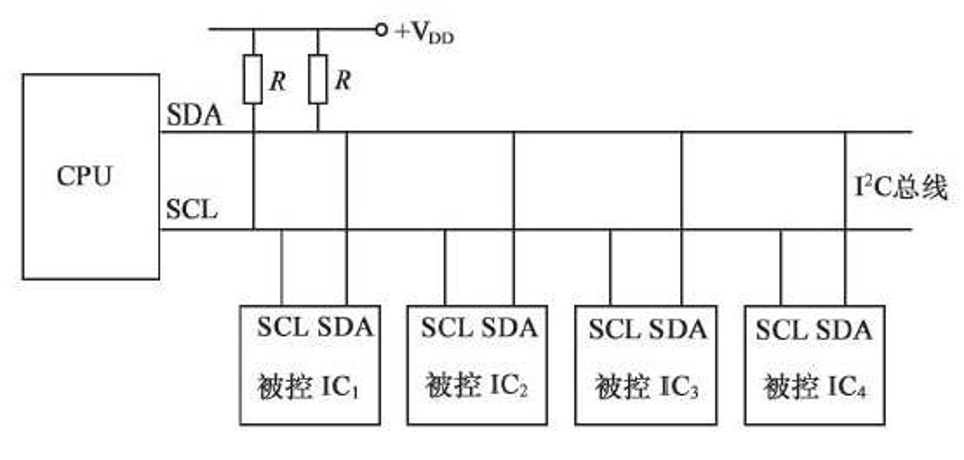
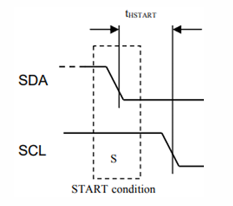
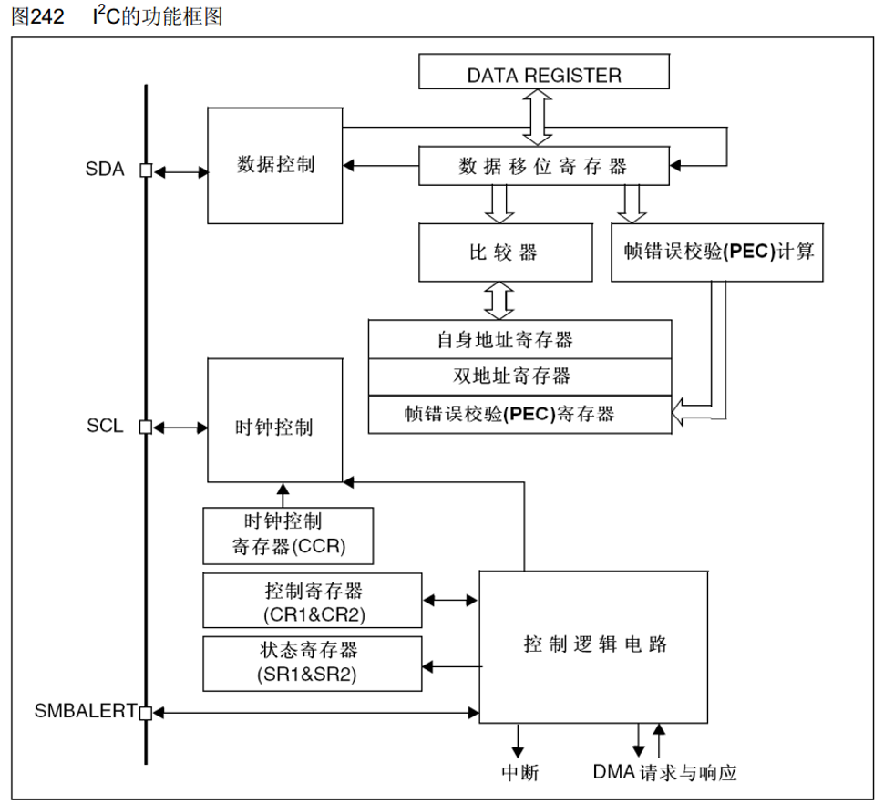

I2C（Inter IC BUS）是 Philips 开发的一种通用数据总线。它只用两根线，就能把多个设备挂在同一条总线上；代价是速度不快，而且协议里有很多细节需要记住。

## 简介

- 两根通信线：`SCL`（Serial Clock）和 `SDA`（Serial Data）。
- 同步、半双工，带数据应答。
- 支持总线挂载多设备：一主多从、多主多从。

| 信号 | 方向 | 作用 |
| --- | --- | --- |
| `SCL` | 主机 → 从机 | 时钟线，决定数据位的采样节拍 |
| `SDA` | 双向 | 数据线，起始/终止条件也由它配合 SCL 产生 |

## 硬件电路

- 所有 I2C 设备的 SCL 连在一起，SDA 连在一起。
- 设备的 SCL 和 SDA 都要配置成开漏输出模式。
- SCL 和 SDA 各接一个上拉电阻，阻值一般在 $4.7k\Omega$ 左右。



> **注意**：开漏输出 + 上拉电阻的意义是——任何设备都可以把总线拉低，但不会强行输出高电平，从而避免多设备同时驱动造成短路。

## 时序基本单元

I2C 的所有通信都由几个基本动作组合而成：起始、发送/接收一个字节、应答、终止。

### 起始与终止

- **起始条件**：SCL 高电平期间，SDA 从高电平切换到低电平。
- **终止条件**：SCL 高电平期间，SDA 从低电平切换到高电平。



### 发送一个字节

SCL 低电平期间，主机把数据位依次放到 SDA 上（高位先行），然后释放 SCL；从机在 SCL 高电平期间读取数据位。因此 **SCL 高电平期间 SDA 不允许变化**。循环 8 次，就是一个字节。

### 接收一个字节

SCL 低电平期间，从机把数据位放到 SDA 上；主机在 SCL 高电平期间读取。循环 8 次即可接收一个字节。主机在接收之前需要释放 SDA。

### 应答

主机接收完一个字节后，在下一个时钟发送一位数据：`0` 表示应答（ACK），`1` 表示非应答（NACK）。主机发送完一个字节后，也会在下一个时钟读取从机的应答位。

## 指定地址写

对于指定设备（Slave Address），在指定地址（Reg Address）下写入指定数据（Data）。这是最常见的寄存器写操作。

当前地址读和指定地址读则依赖从机内部的地址指针。每写入或读出一个字节，指针会自增到下一个位置；当前地址读返回指针当前指向的寄存器值。

## 软件模拟 I2C

使用 STM32 的 GPIO 口模拟 I2C，适合引脚受限或需要灵活控制时序的场景。核心是把 SCL / SDA 的拉高、拉低和延时封装成函数。

```c
void MyI2C_Start(void) {
    MyI2C_W_SDA(1);
    MyI2C_W_SCL(1);
    MyI2C_W_SDA(0);
    MyI2C_W_SCL(0);
}

void MyI2C_Send_Byte(uint8_t Data) {
    for (uint8_t i = 0; i < 8; i++) {
        MyI2C_W_SDA(Data & (0x80 >> i));
        MyI2C_W_SCL(1);
        MyI2C_W_SCL(0);
    }
}

uint8_t MyI2C_Receive_Byte(void) {
    uint8_t Data = 0x00;
    MyI2C_W_SDA(1);
    for (uint8_t i = 0; i < 8; i++) {
        MyI2C_W_SCL(1);
        if (MyI2C_R_SDA() == 1) {
            Data |= (0x80 >> i);
        }
        MyI2C_W_SCL(0);
    }
    return Data;
}
```

读写函数底层仍然是对 GPIO 的操作，并且每次拉高/拉低后加一个短延时。延时的具体值取决于总线速度和上拉电阻，软件模拟时通常留得比硬件 I2C 更宽一些。

## 硬件 I2C

STM32 内部集成了硬件 I2C 收发电路，可以自动生成时钟、起始/终止条件、应答位，并完成数据收发，减轻 CPU 负担。它支持 7 位/10 位地址、标准模式（100kHz）、快速模式（400kHz）、DMA 和 SMBus。



## 容易忘的几点

- SCL 高电平期间，SDA 不允许变化；这是起始/终止条件和数据稳定性的共同基础。
- 上拉电阻不是可选项；没有上拉，开漏输出无法把总线拉高。
- 主机接收数据前要先释放 SDA，否则从机无法驱动数据线。
- 指定地址读本质上是“指定地址写 + 当前地址读”的组合。
- 点亮 SSD1306 OLED 用的就是 I2C：地址通常是 `0x78` 或 `0x7A`，控制字节 `0x00` 表示命令，`0x40` 表示数据。
