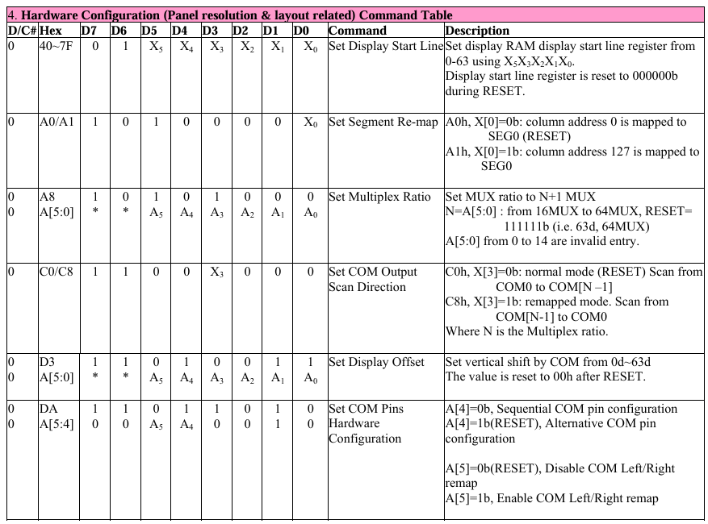
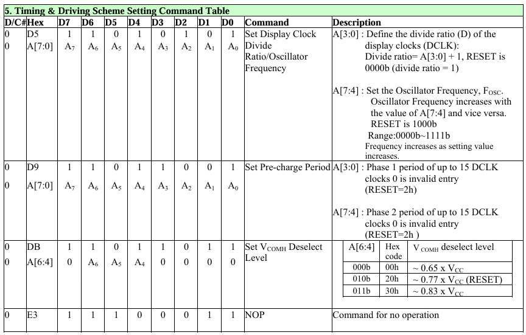

使用 **HY-O096W-H30V** 模块，核心驱动芯片是 SSD1306，分辨率为128×64，单色显示，使用I2C 接口通信。

## 硬件要求
### 1. 接口定义
#### 供电与复位要求

- **VDD（逻辑供电）**：1.65V ~ 3.3V，必须与 MCU 的 I/O 电平一致。
- **VCC（面板驱动供电）**：模块自带内部 DC/DC 电荷泵电路。无需外部提供高压，只需通过软件命令开启电荷泵，芯片内部即可产生 7.0V~7.5V 的驱动电压。
- **RES#（复位引脚）**：低电平有效。上电时建议拉低至少 $3\mu s$ 后再拉高，并在电源稳定后延时 $100ms$ 再发送初始化命令。

#### I2C 接口引脚定义与硬件配置
根据手册，通过配置 BS\[2:0\] 引脚可以选择通信协议。I2C 模式下： 

|模块引脚|对应 SSD1306引脚|功能说明|硬件连接|
|:---:|:---:|:---|:---|
|SCL|D0|I2C 时钟线|接 MCU SCL，需外部上拉电阻（通常4.7$k\Omega$）|
|SDA|D1 / D2|I2C 数据线|D1为输入(SDA_IN)，D2为输出(SDA_OUT)，硬件需将 D1 和 D2 短接后接 MCU SDA，并加上拉电阻|
|RES#|RES#|硬件复位|接 MCU 普通 GPIO（或直接接 VDD）|
|DC/SA0|D/C#|从机地址选择|接地(GND)时地址为 `0x78`；接电源(VDD)时地址为 `0x7A`|
|BS0|BS0|协议选择位|接 GND (逻辑0)|
|BS1|BS1|协议选择位|接 VDD (逻辑1)|
|BS2|BS2|协议选择位|接 GND (逻辑0)|
### 2. 功能（命令控制）

SSD1306 内部拥有128×64 bits的显存（GDDRAM），按8个Page（页，每页8行像素）、128个Column（列）组成。由于I2C串行模式下只能写，不能读，MCU 通过发送控制字节来区分发过去的是“命令”还是“数据”。

#### 通信帧格式
在发送 I2C 设备地址（如 `0x78`）并收到 ACK 后，紧接着发送的 1 个字节为控制字节 (Control Byte)：
- 发命令：控制字节填 `0x00` （Co=0, D/C#=0，后续紧跟着的是命令）
- 发数据：控制字节填 `0x40` （Co=0, D/C#=1，后续紧跟着的是屏幕像素数据）

#### 控制命令集
1. 基础控制命令  

    |命令Hex|参数|功能描述|说明|
    |:---:|:---|:---|:---|
    |`0xAE`|无|关闭显示(Display OFF)|Sleep mode (RESET)|
    |`0xAF`|无|开启显示(Display ON)||
    |`0x81`|`0x00`~`0xFF`|设置对比度/亮度|参数越大越亮(RESET = 7Fh )|
    |`0xA4`|无|恢复显示(Entire Display ON)|正常显示，输出遵循RAM内容。(RESET) |
    |`0xA5`|无|强制全亮(Entire Display ON)|整个显示屏开启，输出忽略RAM内容|
    |`0xA6`|无|正常显示(Normal Display)|(RESET)|
    |`0xA7`|无|反色显示(Inverse Display)||

2. 硬件配置命令
    |命令Hex|参数|功能描述|说明|
    |:---:|:---|:---|:---|
    |`0x40`~`0x7F`|无|设置显示起始行|设置显示RAM的显示起始行寄存器，范围为`0x10`~`0x7F`<br>在RESET（复位）期间，显示起始行寄存器重置为`0x40`|
    |`0xA0`|无|设置段重映射（关）|列地址 0 映射到 SEG0（屏幕正常左右方向）(RESET)|
    |`0xA1`|无|设置段重映射（开）|列地址 127 映射到 SEG0（屏幕左右镜像翻转）|
    |`0xC0`|无|设置 COM 扫描方向（正常）|从 COM0 扫描到 COM\[N-1\]（屏幕正常上下方向）|
    |`0xC8`|无|设置 COM 扫描方向（翻转）|从 COM\[N-1\] 扫描到 COM0（屏幕上下镜像翻转）|
    |`0xA8`|`0x00`~`0x3F`|设置多路复用率 (MUX)|`0x00`~`0x0D`输入无效，<br>0.96寸 128x64 屏幕固定传`0x3F`（即 64 行）|
    |`0xD3`|`0x00`~`0x3F`|设置显示偏移 (Display Offset)|通常设为 `0x00`。用于垂直平移整个画面|
    |`0xDA`|`0x02`/`0x12`|设置 COM 硬件引脚配置|0.96寸屏幕通常传`0x12`（交替引脚配置）|  

    

3. 驱动与时序设置
    |命令Hex|参数|功能描述|说明|
    |:---:|:---|:---|:---|
    |`0x8D`|`0x14`/`0x10`|电荷泵设置 (Charge Pump)|`0x10`：禁用充电泵(RESET)<br>`0x14`：显示时启用电荷泵<br>**注意：** 必须通过以下命令启动电荷泵：<br>1. `0x8D`设置电荷泵；<br>2.`0x14`使能电荷泵；<br>3.`0xAF`开启屏幕|
    |`0xD5`|`0x80`等|设置时钟分频/振荡频率|参数高4位设频率，低4位设分频。<br>低四位定义显示时钟的分频比，Divide ratio = 低四位值+1，RESET时低四位值为0（divide ratio=1）<br>高四位设置Oscillator Frequency($F_{OSC}$)，频率随高四位值增大而增大，反之同理，RESET时高四位值为8，范围：0~15|
    |`0xD9`|`0xF1`等|设置预充电周期|(RESET = `0x22`)|
    |`0xDB`|`0x30`等|设置 VCOMH 电压|(RESET = `0x20`)|

    

4. 显存寻址模式设置
    |命令Hex|参数|功能描述|说明|
    |:---:|:---|:---|:---|
    |`0x20`|`0x00`/`0x01`/`0x02`|设置内存寻址模式|`0x00`：水平寻址 (Horizontal)<br>`0x01`：垂直寻址 (Vertical)<br>`0x02`：页寻址 (Page)(RESET)|


#### 显存定位
SSD1306的物理模型：
- 分辨率：128列 $\times$ 64行
- 分页结构：64行平均分配为8个页，每行8页（Page0~Page7）
- 数据格式：一个字节对应一列上的8个像素点

三种定位方式：  
1. 页寻址模式（Page Addressing Mode,`0x20`,`0x02`）
    - 定位（设置光标）：
        1. 定位页（行）：发送`0xB0 + Page`。
        2. 定位列（列低4位）：发送`0x00 + (Column & 0x0F)`
        3. 定位列（列高4为）：发送`0x10 + ((Column >> 4) & 0x0F)`
    - 写入特征：  
    写入一个字节数据后，列地址会自动加 1。  
    **注意：** 当列地址加到 127 时，不会自动跳到下一页，而是回到第 0 列，页地址保持不变。因此用页寻址写满屏，必须写外层循环切换 Page，内层循环写 128 列。
2. 水平寻址模式（Horizontal Addressing Mode, `0x20,0x00`）
    - 定位（设置光标）：
        1. 设置列范围：发送`0x21`+起始列+结束列（如，`0x21,0x00,0x7F`表示0~127列）。
        2. 设置页范围：发送`0x22`+起始页+结束页（如，`0x22,0x00,0x07`表示0~7列）。
    - 写入特征：  
    写入一个字节数据后，列地址自动加1。  
    **注意：** 当列地址加到设定的“结束列”后，列地址会重置为“起始列”，同时页地址自动加 1。当页地址加到“结束页”后，又回到“起始页”。这就形成了一个类似打字机的自动换行机制，只需无脑往 I2C 总线上灌数据，屏幕会自动铺满。
3. 垂直寻址模式 (Vertical Addressing Mode,`0x20`,`0x01`)
    - 写入特征：  
    写入一个字节后，页地址自动加 1。当页地址加到“结束页”后，页地址重置为“起始页”，同时列地址自动加 1。
4. 显示起始行 (Display Start Line,`0x40`~`0x7F`)  
    这个命令不属于光标控制，但影响显示定位。  
    - 作用：它决定了显存的第几行映射到物理屏幕的最顶端（COM0）。
    - 应用：常用于实现屏幕滚动（Scrolling）效果。如果每过一段时间发送 0x40 + N（N 不断自增），屏幕上的画面就会向上平滑滚动。如果不做滚动，固定发 0x40 即可。

### 3. 与OLED通信
#### I2C接口时序特性

|Symbol|Description|Min|Max|Unit|
|:---:|:---|:---:|:---:|:---:|
|$t_{cycle}$|Clock Cycle Time|2.5|-|$\mu s$|
|$t_{HSTART}$|Start Condition Hold Time|0.6|-|$\mu s$|
|$t_{HD}$|Data Hold Time (for "SDA<sub>OUT</sub>" Pin)|0|-|$ns$|
||Data Hold Time (for "SDA<sub>IN</sub>" Pin)|300|-|$ns$|
|$t_{SD}$|Data Setup Time|100|-|$ns$|
|$t_{SSTART}$|Start Condition Setup Time<br>(Only relevant for a repeated Start condition)|0.6|-|$\mu s$|
|$t_{SSTOP}$|Stop Condition Setup Time|0.6|-|$\mu s$|
|$t_{R}$|Rise Time for Data and Clock Pin| |300|$ns$|
|$t_{F}$|Fall Time for Data and Clock Pin| |300|$ns$|
|$t_{IDLE}$|Idle Time before a New Transmission can Start|1.3|-|$\mu s$|

*(V<sub>DD</sub> - V<sub>SS</sub> = 1.65V to 3.3V, T<sub>a</sub> = 25°C)*


#### 写入数据或命令时序分析
如图所示是IIC协议数据总线上一帧数据的数据格式

流程：
1. 发送起始信号(S) 
2. 确认7位从机地址和1位读写选择（Slave Address+R/W#）   
    R/W#：读写模式，置0代表写模式 
3. 从机应答信号（ACK） 
4. 发送控制字节（Co+D/C#+ Control byte） 
    Co：连续模式，置 1表示每一个 Data byte前都有一个 Control byte，置 0则只有一次 Control   
    byte，后面发送的都是Data byte   
    D/C#：数据指令选择位，置1表示写入的是数据，置0表示写入的是指令   
    Control byte：没实际意义，填0即可 
5. 从机应答信号（ACK） 
6. 发送数据或指令（Data byte）   
    Data byte：要发送的数据或指令，8位，一个字节大小 
7. 从机应答信号（ACK） 
8. 发送终止信号（P）

## 点亮OLED！
### 准备工作
首先打开I2C引脚时钟并进行配置（此处使用I2C1，对应PB6(SCL)，PB7(SDA)），可由STM32CubeMX生成：
```C
I2C_HandleTypeDef hi2c1;

/* I2C1 init function */
void MX_I2C1_Init(void){
  hi2c1.Instance = I2C1;
  hi2c1.Init.ClockSpeed = 400000;
  hi2c1.Init.DutyCycle = I2C_DUTYCYCLE_2;
  hi2c1.Init.OwnAddress1 = 0;
  hi2c1.Init.AddressingMode = I2C_ADDRESSINGMODE_7BIT;
  hi2c1.Init.DualAddressMode = I2C_DUALADDRESS_DISABLE;
  hi2c1.Init.OwnAddress2 = 0;
  hi2c1.Init.GeneralCallMode = I2C_GENERALCALL_DISABLE;
  hi2c1.Init.NoStretchMode = I2C_NOSTRETCH_DISABLE;
  if (HAL_I2C_Init(&hi2c1) != HAL_OK){
    Error_Handler();
  }
}

void HAL_I2C_MspInit(I2C_HandleTypeDef* i2cHandle){
  GPIO_InitTypeDef GPIO_InitStruct = {0};
  if(i2cHandle->Instance==I2C1){
    __HAL_RCC_GPIOB_CLK_ENABLE();
    GPIO_InitStruct.Pin = GPIO_PIN_6|GPIO_PIN_7;
    GPIO_InitStruct.Mode = GPIO_MODE_AF_OD;
    GPIO_InitStruct.Speed = GPIO_SPEED_FREQ_HIGH;
    HAL_GPIO_Init(GPIOB, &GPIO_InitStruct);
    __HAL_RCC_I2C1_CLK_ENABLE();
  }
}

void HAL_I2C_MspDeInit(I2C_HandleTypeDef* i2cHandle){
  if(i2cHandle->Instance==I2C1){
    __HAL_RCC_I2C1_CLK_DISABLE();
    HAL_GPIO_DeInit(GPIOB, GPIO_PIN_6);
    HAL_GPIO_DeInit(GPIOB, GPIO_PIN_7);
  }
}
```
将一些OLED信息设为宏：
```C
#define OLED_Address (0x3C << 1)  //0111 1000
/*屏幕属性*/
#define OLED_High 64
#define OLED_Width 128
#define OLED_SSD_Page 8
```
根据前面提到的写入数据时序分析中的信息，我们先实现向OLED发送命令或数据的功能：
```C
void OLED_WriteCommand(uint8_t cmd) {
    uint8_t buf[2];
    buf[0] = 0x00;
    buf[1] = cmd;
    HAL_I2C_Master_Transmit(&hi2c1,OLED_Address,buf,2,100);
}

void OLED_WriteData(uint8_t data) {
    uint8_t buf[2];
    buf[0] = 0x40;
    buf[1] = data;
    HAL_I2C_Master_Transmit(&hi2c1,OLED_Address,buf,2,100);
}
```
### 初始化OLED
```C
void OLED_Init(void) {
    HAL_Delay(100);
    uint8_t init_cmds[]={
        0x00,       // 控制字节：后续全是命令
        0xAE,       // 关闭显示
        0xD5, 0x80, // 时钟分频
        0xA8, 0x3F, // 复用率
        0xD3, 0x00, // 显示偏移
        0x40,       // 起始行
        0x8D, 0x14, // 开启电荷泵
        0x20, 0x00, // 水平寻址模式
        0xA1,       // 左右翻转
        0xC8,       // 上下翻转
        0xDA, 0x12, // COM引脚配置
        0x81, 0xCF, // 对比度
        0xD9, 0xF1, // 预充电周期
        0xDB, 0x30, // VCOMH电压
        0xA4,       // 恢复显示
        0xA6,       // 正常显示 (非反色)
        0xAF        // 打开显示
    };

    HAL_I2C_Master_Transmit(&hi2c1,OLED_Address,init_cmds,sizeof(init_cmds),100);
}
```
现在OLED就可以正常显示了，但是屏幕有可能会产生花屏，这是SSD1306中未清空内存的原因。因此我们需要一个清屏函数，目的是将SSD1306中的内存均设为`0x00`。为了之后方便管理和计算渲染内容，我们创建一个数组用来存放将要发送到OLED的数据：
```C
uint8_t OLED_Data[OLED_High * OLED_Width + 1]= {0x40};
```
>此处使用了一维数组，是为了方便数据发送和之后的计算，初次可使用二维数组`OLED_Data[OLED_SSD_Page][OLED_Width]`来方便理解SSD1306的结构。  

清空缓存：
```C
void OLED_ClearBuf(void) {
    memset(&OLED_Data[1], 0x00, OLED_High * OLED_Width);
}
```
将缓存内容发送到OLED：
```C
void OLED_Show(void) {
    //设置水平寻址
    OLED_WriteCommand(0x20);
    OLED_WriteCommand(0x00);
    //设置列范围
    OLED_WriteCommand(0x21);
    OLED_WriteCommand(0x00);
    OLED_WriteCommand(0x7F);
    //设置页范围
    OLED_WriteCommand(0x22);
    OLED_WriteCommand(0x00);
    OLED_WriteCommand(0x07);

    HAL_I2C_Master_Transmit(&hi2c1,OLED_Address,OLED_Data,1025,100);
}
```
这样清空函数就完成了，然后就可在`OLED_Init()`函数中调用了：
```C
void OLED_Clear(void) {
    OLED_ClearBuf();
    OLED_Show();
}
```

### 自定义显示
既然点亮了屏幕，总要显示点什么上去！我们可以使用页寻址来控制SSD1306中每一页的内存，将每一页设为一行，来方便的进行字符串的显示。但是，如果要显示的字符串不在同一页怎么办？   

就要把整个屏幕从物理的页映射为`col,row`，也就是 $x,y$ 坐标。

我们来写一个映射函数：
```C
/**
 * @brief 空间坐标到显存的映射
 * @param row 0 ~ (OLED_High-1)     y
 * @param col 0 ~ (OLED_Width-1)    x
 * @param data 0 or 1
 */
void OLED_DrawPixel(uint8_t row,uint8_t col,uint8_t data) {
    if (row >= OLED_High || col >= OLED_Width) return;
    uint8_t page = row / OLED_SSD_Page;
    uint8_t byte_pos = row % OLED_SSD_Page;
    uint16_t index = 1 + (page * OLED_Width) + col;

    if (data) {
        OLED_Data[index] |= (1 << byte_pos);  // 置1
    } else {
        OLED_Data[index] &= ~(1 << byte_pos); // 置0
    }
}
```
这样我们就可以跳过页的限制，轻松的控制屏幕中的内容了。写一个在屏幕中心显示一个$32\times32$的正方形的功能：
```C
void OLED_DrawSquare(void) {
    for (uint8_t y = 0; y < 64; y++) {
        for (uint8_t x = 0; x < 128; x++) {
            uint8_t pixel = 0;
            if (y >= 16 && y <= 47 && x >= 48 && x <= 79) {
                pixel = 1;
            }
            OLED_DrawPixel(y, x, pixel);
        }
    }
}
```

---

这样，我们就基本实现了点亮OLED的任务。

## 相关

- [I2C 通信协议](../i2c/)

