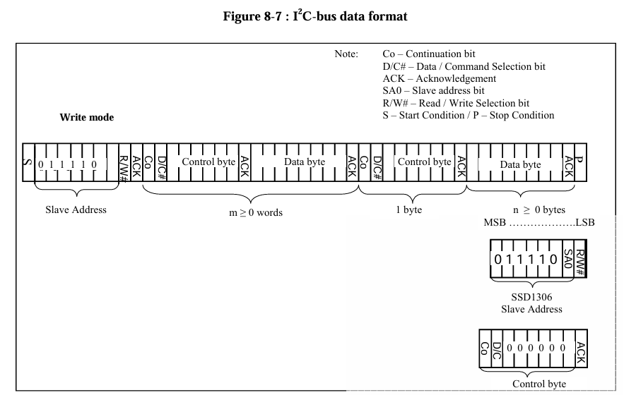

使用 **HY-O096W-H30V** 模块，核心驱动芯片是 SSD1306：128×64、单色、I2C 接口。

## 硬件要求

### 供电与复位

- **VDD（逻辑供电）**：1.65V ~ 3.3V，必须与 MCU 的 I/O 电平一致。
- **VCC（面板驱动供电）**：模块自带内部 DC/DC 电荷泵，不需要外部高压；通过软件命令开启电荷泵，芯片内部产生 7.0V ~ 7.5V 的驱动电压。
- **RES#（复位）**：低电平有效。上电时建议拉低至少 $3\mu s$，拉高后延时 $100ms$ 再发送初始化命令。

### I2C 引脚

| 模块引脚 | 对应 SSD1306 引脚 | 功能 | 硬件连接 |
| --- | --- | --- | --- |
| SCL | D0 | I2C 时钟线 | 接 MCU SCL，加上拉电阻 |
| SDA | D1 / D2 | I2C 数据线 | D1 输入、D2 输出，短接后接 MCU SDA |
| RES# | RES# | 硬件复位 | 接 GPIO 或 VDD |
| DC/SA0 | D/C# | 从机地址选择 | 接地为 `0x78`，接 VDD 为 `0x7A` |
| BS0 | BS0 | 协议选择 | 接 GND |
| BS1 | BS1 | 协议选择 | 接 VDD |
| BS2 | BS2 | 协议选择 | 接 GND |

## 显存结构

SSD1306 内部有 128×64 bits 的显存（GDDRAM），按 8 个 Page、128 个 Column 组织。由于 I2C 串行模式只能写、不能读，MCU 通过控制字节区分“命令”和“数据”：

- 发命令：控制字节 `0x00`
- 发数据：控制字节 `0x40`

## 常用命令

| 命令 Hex | 参数 | 功能 |
| --- | --- | --- |
| `0xAE` | 无 | 关闭显示 |
| `0xAF` | 无 | 开启显示 |
| `0x81` | `0x00` ~ `0xFF` | 设置对比度 |
| `0xA6` / `0xA7` | 无 | 正常显示 / 反色显示 |
| `0x20` | `0x00` / `0x01` / `0x02` | 水平 / 垂直 / 页寻址 |
| `0x21` | 起始列、结束列 | 设置列范围 |
| `0x22` | 起始页、结束页 | 设置页范围 |
| `0x8D` | `0x14` | 启用电荷泵 |
| `0xB0 + Page` | 无 | 页寻址模式下定位页 |


## 页寻址

页寻址模式（`0x20, 0x02`）的定位步骤：

1. 发送 `0xB0 + Page` 定位页；
2. 发送 `0x00 + (Column & 0x0F)` 定位列低 4 位；
3. 发送 `0x10 + ((Column >> 4) & 0x0F)` 定位列高 4 位。

写入一个字节后，列地址自动加 1。当列地址加到 127 时，不会自动跳到下一页，而是回到第 0 列，页地址保持不变。因此用页寻址写满屏，需要外层循环切换 Page，内层循环写 128 列。

## 水平寻址

水平寻址模式（`0x20, 0x00`）适合连续写满整屏：

1. `0x21, 0x00, 0x7F` 设置 0 ~ 127 列；
2. `0x22, 0x00, 0x07` 设置 0 ~ 7 页。

之后每写一个字节，列地址自动加 1；写到结束列后回到起始列，页地址加 1。页地址写到结束页后回到起始页，形成类似打字机的自动换行。

## I2C 时序特性

| 符号 | 描述 | 最小 | 最大 | 单位 |
| --- | --- | --- | --- | --- |
| $t_{cycle}$ | 时钟周期 | 2.5 | - | $\mu s$ |
| $t_{HSTART}$ | 起始条件保持时间 | 0.6 | - | $\mu s$ |
| $t_{SD}$ | 数据建立时间 | 100 | - | $ns$ |
| $t_{R}$ | 上升时间 | - | 300 | $ns$ |
| $t_{F}$ | 下降时间 | - | 300 | $ns$ |
| $t_{IDLE}$ | 新传输开始前的空闲时间 | 1.3 | - | $\mu s$ |


#### 写入数据或命令时序分析
如图所示是IIC协议数据总线上一帧数据的数据格式

流程：
1. 发送起始信号(S) 
2. 确认7位从机地址和1位读写选择（Slave Address+R/W#）   
    R/W#：读写模式，置0代表写模式 
3. 从机应答信号（ACK） 
4. 发送控制字节（Co+D/C#+ Control byte） 
    Co：连续模式，置 1表示每一个 Data byte前都有一个 Control byte，置 0则只有一次 Control   
    byte，后面发送的都是Data byte   
    D/C#：数据指令选择位，置1表示写入的是数据，置0表示写入的是指令   
    Control byte：没实际意义，填0即可 
5. 从机应答信号（ACK） 
6. 发送数据或指令（Data byte）   
    Data byte：要发送的数据或指令，8位，一个字节大小 
7. 从机应答信号（ACK） 
8. 发送终止信号（P）

## 点亮OLED！
### 准备工作
首先打开I2C引脚时钟并进行配置（此处使用I2C1，对应PB6(SCL)，PB7(SDA)），可由STM32CubeMX生成：
```C
I2C_HandleTypeDef hi2c1;

/* I2C1 init function */
void MX_I2C1_Init(void){
  hi2c1.Instance = I2C1;
  hi2c1.Init.ClockSpeed = 400000;
  hi2c1.Init.DutyCycle = I2C_DUTYCYCLE_2;
  hi2c1.Init.OwnAddress1 = 0;
  hi2c1.Init.AddressingMode = I2C_ADDRESSINGMODE_7BIT;
  hi2c1.Init.DualAddressMode = I2C_DUALADDRESS_DISABLE;
  hi2c1.Init.OwnAddress2 = 0;
  hi2c1.Init.GeneralCallMode = I2C_GENERALCALL_DISABLE;
  hi2c1.Init.NoStretchMode = I2C_NOSTRETCH_DISABLE;
  if (HAL_I2C_Init(&hi2c1) != HAL_OK){
    Error_Handler();
  }
}

void HAL_I2C_MspInit(I2C_HandleTypeDef* i2cHandle){
  GPIO_InitTypeDef GPIO_InitStruct = {0};
  if(i2cHandle->Instance==I2C1){
    __HAL_RCC_GPIOB_CLK_ENABLE();
    GPIO_InitStruct.Pin = GPIO_PIN_6|GPIO_PIN_7;
    GPIO_InitStruct.Mode = GPIO_MODE_AF_OD;
    GPIO_InitStruct.Speed = GPIO_SPEED_FREQ_HIGH;
    HAL_GPIO_Init(GPIOB, &GPIO_InitStruct);
    __HAL_RCC_I2C1_CLK_ENABLE();
  }
}

void HAL_I2C_MspDeInit(I2C_HandleTypeDef* i2cHandle){
  if(i2cHandle->Instance==I2C1){
    __HAL_RCC_I2C1_CLK_DISABLE();
    HAL_GPIO_DeInit(GPIOB, GPIO_PIN_6);
    HAL_GPIO_DeInit(GPIOB, GPIO_PIN_7);
  }
}
```
将一些OLED信息设为宏：
```C
#define OLED_Address (0x3C << 1)  //0111 1000
/*屏幕属性*/
#define OLED_High 64
#define OLED_Width 128
#define OLED_SSD_Page 8
```
根据前面提到的写入数据时序分析中的信息，我们先实现向OLED发送命令或数据的功能：
```C
void OLED_WriteCommand(uint8_t cmd) {
    uint8_t buf[2];
    buf[0] = 0x00;
    buf[1] = cmd;
    HAL_I2C_Master_Transmit(&hi2c1,OLED_Address,buf,2,100);
}

void OLED_WriteData(uint8_t data) {
    uint8_t buf[2];
    buf[0] = 0x40;
    buf[1] = data;
    HAL_I2C_Master_Transmit(&hi2c1,OLED_Address,buf,2,100);
}
```
### 初始化OLED
```C
void OLED_Init(void) {
    HAL_Delay(100);
    uint8_t init_cmds[]={
        0x00,       // 控制字节：后续全是命令
        0xAE,       // 关闭显示
        0xD5, 0x80, // 时钟分频
        0xA8, 0x3F, // 复用率
        0xD3, 0x00, // 显示偏移
        0x40,       // 起始行
        0x8D, 0x14, // 开启电荷泵
        0x20, 0x00, // 水平寻址模式
        0xA1,       // 左右翻转
        0xC8,       // 上下翻转
        0xDA, 0x12, // COM引脚配置
        0x81, 0xCF, // 对比度
        0xD9, 0xF1, // 预充电周期
        0xDB, 0x30, // VCOMH电压
        0xA4,       // 恢复显示
        0xA6,       // 正常显示 (非反色)
        0xAF        // 打开显示
    };

    HAL_I2C_Master_Transmit(&hi2c1,OLED_Address,init_cmds,sizeof(init_cmds),100);
}
```
现在OLED就可以正常显示了，但是屏幕有可能会产生花屏，这是SSD1306中未清空内存的原因。因此我们需要一个清屏函数，目的是将SSD1306中的内存均设为`0x00`。为了之后方便管理和计算渲染内容，我们创建一个数组用来存放将要发送到OLED的数据：
```C
uint8_t OLED_Data[OLED_High * OLED_Width + 1]= {0x40};
```
>此处使用了一维数组，是为了方便数据发送和之后的计算，初次可使用二维数组`OLED_Data[OLED_SSD_Page][OLED_Width]`来方便理解SSD1306的结构。  

清空缓存：
```C
void OLED_ClearBuf(void) {
    memset(&OLED_Data[1], 0x00, OLED_High * OLED_Width);
}
```
将缓存内容发送到OLED：
```C
void OLED_Show(void) {
    //设置水平寻址
    OLED_WriteCommand(0x20);
    OLED_WriteCommand(0x00);
    //设置列范围
    OLED_WriteCommand(0x21);
    OLED_WriteCommand(0x00);
    OLED_WriteCommand(0x7F);
    //设置页范围
    OLED_WriteCommand(0x22);
    OLED_WriteCommand(0x00);
    OLED_WriteCommand(0x07);

    HAL_I2C_Master_Transmit(&hi2c1,OLED_Address,OLED_Data,1025,100);
}
```
这样清空函数就完成了，然后就可在`OLED_Init()`函数中调用了：
```C
void OLED_Clear(void) {
    OLED_ClearBuf();
    OLED_Show();
}
```

### 自定义显示
既然点亮了屏幕，总要显示点什么上去！我们可以使用页寻址来控制SSD1306中每一页的内存，将每一页设为一行，来方便的进行字符串的显示。但是，如果要显示的字符串不在同一页怎么办？   

就要把整个屏幕从物理的页映射为`col,row`，也就是 $x,y$ 坐标。

我们来写一个映射函数：
```C
/**
 * @brief 空间坐标到显存的映射
 * @param row 0 ~ (OLED_High-1)     y
 * @param col 0 ~ (OLED_Width-1)    x
 * @param data 0 or 1
 */
void OLED_DrawPixel(uint8_t row,uint8_t col,uint8_t data) {
    if (row >= OLED_High || col >= OLED_Width) return;
    uint8_t page = row / OLED_SSD_Page;
    uint8_t byte_pos = row % OLED_SSD_Page;
    uint16_t index = 1 + (page * OLED_Width) + col;

    if (data) {
        OLED_Data[index] |= (1 << byte_pos);  // 置1
    } else {
        OLED_Data[index] &= ~(1 << byte_pos); // 置0
    }
}
```
这样我们就可以跳过页的限制，轻松的控制屏幕中的内容了。写一个在屏幕中心显示一个$32\times32$的正方形的功能：
```C
void OLED_DrawSquare(void) {
    for (uint8_t y = 0; y < 64; y++) {
        for (uint8_t x = 0; x < 128; x++) {
            uint8_t pixel = 0;
            if (y >= 16 && y <= 47 && x >= 48 && x <= 79) {
                pixel = 1;
            }
            OLED_DrawPixel(y, x, pixel);
        }
    }
}
```

---

这样，我们就基本实现了点亮OLED的任务。

## 相关

- [I2C 通信协议](../i2c/)
- 地址通常为 `0x78`（SA0 接地）或 `0x7A`（SA0 接 VDD）。
