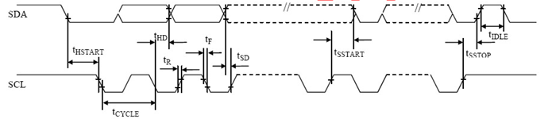

使用 **HY-O096W-H30V** 模块，核心驱动芯片是 SSD1306：128×64、单色、I2C 接口。

## 硬件要求

### 供电与复位

- **VDD（逻辑供电）**：1.65V ~ 3.3V，必须与 MCU 的 I/O 电平一致。
- **VCC（面板驱动供电）**：模块自带内部 DC/DC 电荷泵，不需要外部高压；通过软件命令开启电荷泵，芯片内部产生 7.0V ~ 7.5V 的驱动电压。
- **RES#（复位）**：低电平有效。上电时建议拉低至少 $3\mu s$，拉高后延时 $100ms$ 再发送初始化命令。

### I2C 引脚

| 模块引脚 | 对应 SSD1306 引脚 | 功能 | 硬件连接 |
| --- | --- | --- | --- |
| SCL | D0 | I2C 时钟线 | 接 MCU SCL，加上拉电阻 |
| SDA | D1 / D2 | I2C 数据线 | D1 输入、D2 输出，短接后接 MCU SDA |
| RES# | RES# | 硬件复位 | 接 GPIO 或 VDD |
| DC/SA0 | D/C# | 从机地址选择 | 接地为 `0x78`，接 VDD 为 `0x7A` |
| BS0 | BS0 | 协议选择 | 接 GND |
| BS1 | BS1 | 协议选择 | 接 VDD |
| BS2 | BS2 | 协议选择 | 接 GND |

## 显存结构

SSD1306 内部有 128×64 bits 的显存（GDDRAM），按 8 个 Page、128 个 Column 组织。由于 I2C 串行模式只能写、不能读，MCU 通过控制字节区分“命令”和“数据”：

- 发命令：控制字节 `0x00`
- 发数据：控制字节 `0x40`

## 常用命令

| 命令 Hex | 参数 | 功能 |
| --- | --- | --- |
| `0xAE` | 无 | 关闭显示 |
| `0xAF` | 无 | 开启显示 |
| `0x81` | `0x00` ~ `0xFF` | 设置对比度 |
| `0xA6` / `0xA7` | 无 | 正常显示 / 反色显示 |
| `0x20` | `0x00` / `0x01` / `0x02` | 水平 / 垂直 / 页寻址 |
| `0x21` | 起始列、结束列 | 设置列范围 |
| `0x22` | 起始页、结束页 | 设置页范围 |
| `0x8D` | `0x14` | 启用电荷泵 |
| `0xB0 + Page` | 无 | 页寻址模式下定位页 |

## 页寻址

页寻址模式（`0x20, 0x02`）的定位步骤：

1. 发送 `0xB0 + Page` 定位页；
2. 发送 `0x00 + (Column & 0x0F)` 定位列低 4 位；
3. 发送 `0x10 + ((Column >> 4) & 0x0F)` 定位列高 4 位。

写入一个字节后，列地址自动加 1。当列地址加到 127 时，不会自动跳到下一页，而是回到第 0 列，页地址保持不变。因此用页寻址写满屏，需要外层循环切换 Page，内层循环写 128 列。

## 水平寻址

水平寻址模式（`0x20, 0x00`）适合连续写满整屏：

1. `0x21, 0x00, 0x7F` 设置 0 ~ 127 列；
2. `0x22, 0x00, 0x07` 设置 0 ~ 7 页。

之后每写一个字节，列地址自动加 1；写到结束列后回到起始列，页地址加 1。页地址写到结束页后回到起始页，形成类似打字机的自动换行。

## I2C 时序特性

| 符号 | 描述 | 最小 | 最大 | 单位 |
| --- | --- | --- | --- | --- |
| $t_{cycle}$ | 时钟周期 | 2.5 | - | $\mu s$ |
| $t_{HSTART}$ | 起始条件保持时间 | 0.6 | - | $\mu s$ |
| $t_{SD}$ | 数据建立时间 | 100 | - | $ns$ |
| $t_{R}$ | 上升时间 | - | 300 | $ns$ |
| $t_{F}$ | 下降时间 | - | 300 | $ns$ |
| $t_{IDLE}$ | 新传输开始前的空闲时间 | 1.3 | - | $\mu s$ |

## 初始化顺序

1. 拉低 RES#，延时，再拉高；
2. 延时 100ms；
3. 发送 `0xAE` 关闭显示；
4. 设置时钟、复用率、偏移、起始行；
5. 启用电荷泵：`0x8D, 0x14`；
6. 设置寻址模式和显存范围；
7. 清空显存；
8. 发送 `0xAF` 开启显示。

## 相关

- [I2C 通信协议](../i2c/)
- 地址通常为 `0x78`（SA0 接地）或 `0x7A`（SA0 接 VDD）。
