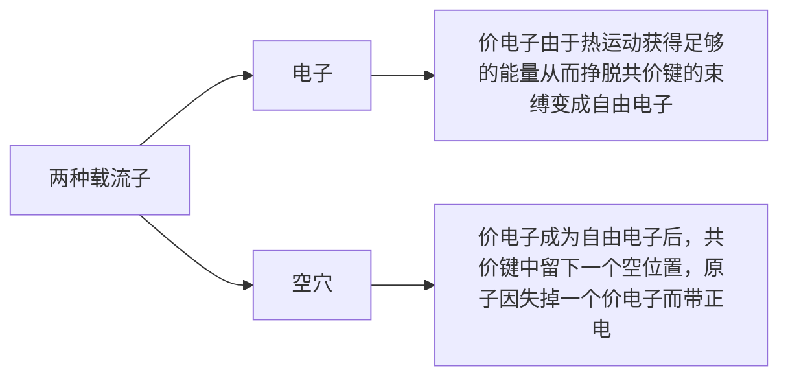

## 本征半导体
纯净的具有晶体结构的半导体称为**本征半导体**。
### 半导体的“半导”
物质的导电性取决于原子结构。低价元素一般为导体，因为它们的最外层电子极易挣脱原子核的束缚成为自由电子，自由电子在外电场的作用下产生定向移动，形成电流。

常用的半导体材料硅（Si）和锗（Ge）均为四价元素，它们的最外层电子既不像导体那么容易挣脱原子核的束缚，也不像绝缘体那样被原子核束缚得那么紧，因而其导电性介于二者之间。

### 本征半导体中的两种载流子
晶体中的共价键在常温下，有极少数的价电子由于热运动（热激发）获得足够的能量挣脱共价键的束缚变成**自由电子**，同时在共价键中留下一个位置，被称为空穴。

运载电荷的粒子称为**载流子**。

与普通导体的区别：导体导电只有一种载流子，即自由电子导电；**本征半导体有两种载流子，即自由电子和空穴均参与导电**，这是半导体导电的特殊性质。

### 本征半导体中载流子的浓度
在一定的温度下，本征激发所产生的自由电子与空穴对，与复合的自由电子与空穴对数目相等，故达到**动态平衡**。  

换句话说，在一定温度下，本征半导体中载流子的浓度是一定的，并且自由电子与空穴的浓度相等。当环境温度升高时，热运动加剧，挣脱共价键束缚的自由电子增多，空穴也随之增多，即载流子的浓度升高，因而必然使得导电性能增强，反之亦然。可见，本征半导体载流子的浓度是环境温度的函数。  

理论分析表明，本征半导体载流子的浓度为

$$
\begin{align}
n_i=p_i=K_1T^{\frac{3}{2}}e^{\frac{-E_{GO}}{(2kT)}}
\end{align}
$$

式中 $n_i$ 和 $p_i$ 分别表示自由电子与空穴的浓度（$cm^{-3}$），$K_1$ 是与半导体材料载流子有效质量、有效能级密度有关的常量（硅为 $3.87 \times 10^{16} cm^{-3} \cdot K^{-\frac{3}{2}}$，锗为 $1.76\times 10^{16} cm^{-3}\cdot K^{-\frac{3}{2}}$）,$T$ 为热力学温度，$k$ 为玻尔兹曼常数（$8.63\times 10^{-5} eV/K$），$E_{GO}$ 为热力学零度时破坏共价键所需的能量，又称禁带宽度（硅为 $1.21eV$ ，锗为 $0.785eV$）。

式（1）表明，当 $T=0K$ 时，自由电子与空穴的浓度均为零，本征半导体成为绝缘体；在一定范围内，当温度升高时，本征半导体载流子的浓度近似按指数曲线升高。在常温下，即 $T=300K$ 时，硅材料的本质载流子浓度 $n_i=p_i=1.43\times 10^{10}cm^{-3}$ ，锗材料的本征载流子浓度 $n_i=p_i=2.38\times 10^{13}cm^{-3}$ 。

应当指出，本征半导体的导电性能很差，且与环境温度密切相关。半导体材料性能对温度的这种敏感性，既可以用来制作热敏和光敏器件，又是造成半导体器件温度稳定性差的原因。

### 半导体如何导电？
#### 微观原理

1. 载流子产生  
   
    本征半导体中，价电子受热激发脱离共价键，成为自由电子，同时在原位置留下一个空穴。电子和空穴成对产生，浓度相等。

2. 自由电子的运动  
   
    自由电子带负电，在电场中受电场力方向与电场相反，因此逆电场方向漂移。它形成的电子电流方向与电场方向相同。

3. 空穴的“运动”本质  
   
    空穴不是真正自由飞行的正电荷粒子，而是共价键中的空位。电场下，附近的价电子依次跳过来填补空穴，自己原来的位置又形成新空穴。宏观上看，空穴沿电场方向移动；微观本质是价电子逆电场方向接力填补空穴。

4. 空穴电流的本质  

    空穴电流可等效为带正电的空穴顺电场运动形成的电流；其物理本质是价电子接力运动形成的电流效果。电子电流和空穴电流方向相同，不是相反。

5. 产生与复合的关系  

    热激发不断产生电子-空穴对，复合也不断发生，热平衡下产生率等于复合率。复合会使载流子消失，但不是定向电流的来源；定向电流来自电场下的漂移运动。

#### 宏观原理

1. 外加电压建立电场
    
    半导体两端加电压后，内部建立电场，方向从高电位端指向低电位端。

2. 漂移电流
    
    电子逆电场漂移，空穴等效顺电场漂移，两者都贡献沿电场方向的电流。半导体内部总电流密度可写为

    $$
    \begin{align*}
        J=e(n\mu_n+p\mu_p)E
    \end{align*}
    $$

    本征半导体中 $n=p=n_i$ ，所以

    $$
    \begin{align*}
        J=en_i(\mu_n+\mu_p)E
    \end{align*}
    $$

3. 电流方向
    
    半导体内部电流方向沿电场方向，即从正端指向负端；外电路和电极通过注入/抽出载流子维持电流连续。

4. 本征半导体的特点
    
    载流子浓度低，电导率较小；温度升高时热激发增强，电子空穴对增多，电导率增大。

## 本征半导体的知识点

### 必须掌握的 10 个核心知识点
1. 本征半导体的定义

    纯净、无有意掺杂、晶格完整的半导体。载流子只来自热激发。

2. 共价键结构

    硅/锗原子通过共价键结合；价电子被束缚在共价键中，不能自由导电。

3. 热激发产生电子-空穴对
    
    价电子获得足够能量脱离共价键 → 成为自由电子，原位置留下空穴。
    关键：电子和空穴成对产生，数量相等。

4. 本征载流子浓度 $n_i$  
​   本征半导体中：

    $$
    \begin{align*}
        n = p = n_i
    \end{align*}
    $$
    这是本征半导体最重要的定量结论。

5. 空穴的本质
    
    空穴不是真正自由飞行的正电荷粒子，而是共价键中的空位；空穴导电本质是价电子接力填补空穴的等效结果。

6. 电子电流和空穴电流的方向关系
    
    自由电子带负电，逆电场漂移；空穴等效带正电，顺电场漂移。
    两者运动方向相反，但形成的电流方向相同，相互叠加。

7. 漂移运动的概念
    
    载流子在电场作用下的定向运动叫漂移。
    本征半导体加电场后，电子和空穴都参与漂移导电。

8. 漂移电流密度公式
    
    $$
    \begin{align*}
        J=e(n\mu_{n}+p\mu_{p})E
    \end{align*}
    $$
    本征时 $n=p=n_i$：
    $$
    \begin{align*}
        J=en_i(\mu_n+\mu_p)E
    \end{align*}
    $$
    要理解 $\mu_n$ ，$\mu_p$ 是电子和空穴迁移率。

9. 产生与复合的动态平衡
    
    热激发不断产生电子-空穴对，复合不断发生；热平衡下产生率=复合率，$n_i$ 保持稳定。
    复合不是定向电流的来源，漂移才是。

10.  温度对导电性的影响
    
    本征半导体温度升高 → 热激发增强 → $n_i$ 增大 → 电导率增大。
    这是本征半导体与金属导电的重要区别。

### 需要理解但不必死记的 4 点
1. 本征费米能级位置
    
    在本征半导体中，费米能级接近禁带中线。知道结论即可。

2. 禁带宽度的影响
    
    禁带越宽，热激发越难，$n_i$ 越小。硅比锗的 $n_i$ 小。

3. 电中性条件
    
    本征半导体整体电中性：正负电荷总量相等，所以 $n=p$。
4. 本征半导体电导率较低
    
    因为 $n_i$ 很小，所以本征电导率低；实用器件通常靠掺杂提高导电性。

### 最容易混淆、但必须分清的 3 件事
1. “空穴移动” ≠ 空穴粒子在飞
    
    空穴移动是价电子接力填补空位的宏观表现。

2. “电子和空穴运动方向相反” ≠ “电流方向相反”
    
    电荷符号相反，所以运动方向相反时，电流方向反而相同。

3. “复合” ≠ “产生电流”
    
    复合是载流子消失；定向电流来自电场下的漂移。产生和复合在热平衡下动态平衡。

---

> 本征半导体中热激发成对产生自由电子和空穴，$n=p=n_i$ ；加电场后电子逆电场漂移、空穴等效顺电场漂移，二者电流同向叠加；空穴导电本质是价电子接力填补空位；复合不是定向电流来源，温度升高使 $n_i$ 增大、电导率增大。