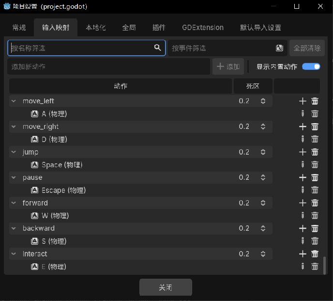

## 输入映射
要移动角色，就要监听玩家的输入，比如按下方向键。在 Godot 中能够使用代码来绑定按键，但还有一个非常强大的系统，可以为一系列按键和按钮设置标签。这样可以简化我们的脚本，让它们更易读。

这个系统是“输入映射”。可以在项目菜单中选择项目设置...来打开编辑器。

窗口顶部设有多个选项卡。点击“输入映射”。可以在这个窗口上部添加新的动作——即动作标签。

要为动作绑定按键或按钮，点击右侧的"+"按钮。对 move_left 执行此操作，按下左方向键，然后单击确定。



添加并绑定对应的按键。

在“输入映射”中设置的按键映射也可以通过使用`InputMap`在运行时进行修改。

## 镜头移动

在节点 `Camera3D` 上添加脚本。

相机要完成以下任务：
- 始终看向 `Player` 和跟随其移动
- 响应鼠标移动
  
在最开始，先获取对应角色的位置设置相机的位置，一般情况下相机位置在对应角色位置的后上方。

在游戏运行中要保持相机看向角色（使用`look_at()`），且要在鼠标移动时进行响应，使用`func _unhandled_input(event:InputEvent) -> void`处理输入的瞬时响应任务。

```gdscript
@export var character:Node3D
@export var base_distance:float = 8

var yaw:float = 0.0
var pitch:float = 0.0
var offset_2D:Vector3  	#背后

func _ready() -> void:
	offset_2D = Vector3(0,0,base_distance)
	pitch = -deg_to_rad(26)
	global_position = character.global_position + offset_2D.rotated(Vector3.UP,yaw).rotated(Vector3.RIGHT,pitch) 	#初始化

func _unhandled_input(event: InputEvent) -> void:
	yaw += pow(-1.0,control) * (event.screen_relative.x * CAMERA_SENSITIVITY)  	#左右
	pitch += pow(-1.0,control_y) * (event.screen_relative.y * CAMERA_SENSITIVITY)	#上下
	pitch = clamp(pitch,deg_to_rad(-70),deg_to_rad(70))

func _process(delta: float) -> void:
	global_position = character.global_position + offset_2D.rotated(Vector3.RIGHT,pitch).rotated(Vector3.UP,yaw)
	look_at(character.global_position,Vector3(0,1,0),false)
```

## 人物控制

控制人物需要：
- 处理物理环境
- 处理键盘的输入映射
- 保持角色朝向与相机方向一致

```gdscript
const ACCELERATION:float = 60.0
const MAX_SPEED:float = 5.0
const JUMP_VELOCITY:float = 6.7
const COYOTE_TIME: float = 0.12

var gravity = ProjectSettings.get_setting("physics/3d/default_gravity")
var coyote: float

@export var camera:Camera3D

func _physics_process(delta: float) -> void:
	#rotation
	var angle = camera.global_rotation.y
	#move
	if not is_on_floor():
		velocity.y -= (gravity+11) * delta
		coyote -= delta
	else:
		coyote = COYOTE_TIME
	if Input.is_action_just_pressed("jump") and coyote > 0:
		velocity.y = JUMP_VELOCITY
		coyote = 0
	var direction:Vector2 = Input.get_vector("move_left","move_right","forward""backward")
	var targetV:Vector3 = Vector3(direction.x,0,direction.y).rotated(Vector3.UP,angle)* MAX_SPEED
	velocity.x = move_toward(velocity.x,targetV.x,ACCELERATION * delta)
	velocity.z = move_toward(velocity.z,targetV.z,ACCELERATION * delta)
	
	move_and_slide()
```


