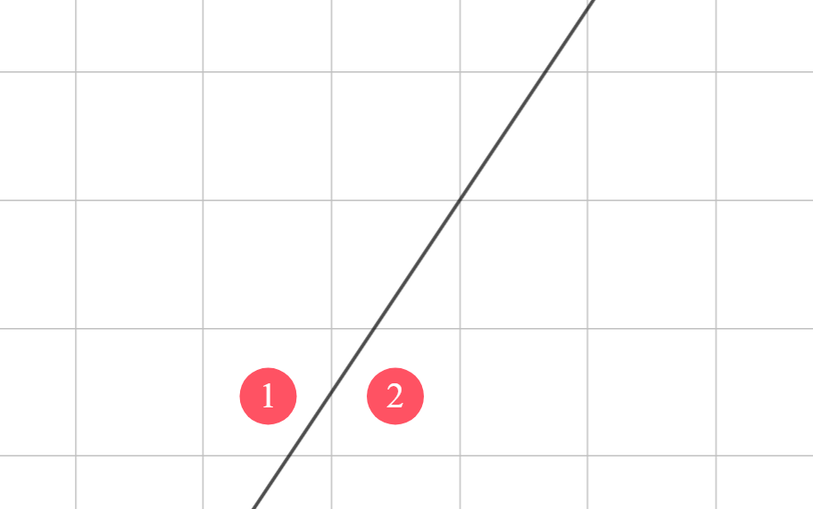

# 在二维平面上作画

之前我们点亮了一个OLED显示屏，并实现了一些基础操作。现在我们更进一步，研究一下如何在二维平面上显示更多内容。

我们都知道，在数学中，点、线、面是构成平面的三大基础元素，在OLED驱动中，我们已经通过`OLED_DrawPixel(x,y,data)`完成了画点的操作，接下来我们来研究如何画线。

## 直线

画直线是非常容易的，只需要让 $(x_1,y_1)\to(x_2,y_2)$ 的点置1就好了。但是，屏幕是由像素点构成的，所以只能显示栅格图，不能显示计算得来的矢量图，因此，我们在画斜率不等于0或 $x=C$ 的直线时，会遇到以下的情况：

如图，如果将网格视为一个像素，一条直线穿过1、2号像素，应该点亮1号像素还是2号像素呢？我们有一些算法来完成这个操作：

假设我们要从点 $(x_0,y_0)$ 画到 $(x_1,y_1)$。最简单的数学公式是：$y=kx+b$
### DDA 算法（数字微分分析仪）
直线的斜率为 $k = \frac{\Delta y}{\Delta x}$ 。从起点开始，循环 $x$ 从 $x_0$ 到 $x_1$ 。既然每次计算时 $x$ 都增加 $1$，那么 $y$ 每次就增加 $k$ 。因为屏幕像素是整数，还要进行取整： `DrawPixel(x,(int)(y + 0.5),1)` 。  
缺点：包含大量的浮点加法和强制类型转换，在没有硬件浮点运算单元的平台上运算速度极慢。

### Bresenham 算法
对于一条直线 $l: y = kx + b$ 。  
当 $k>0$ 时，我们要在 $(x_k,y_k)$ 走到下一步 $x_k+1$ 时，要决定是往正右方走到 $(x_k+1,y_k)$ 还是往右上方走到 $(x_k+1,y_k+1)$ ：  
假设直线方程是隐式的：$F(x,y)=\Delta y \cdot x-\Delta x \cdot y + b = 0$.  
当在 $x_k+1$ 的位置时，理想直线上的 $y$ 坐标为： $y_{real} = y_k + \frac{\Delta y}{\Delta x}$。此时，有两个候选像素：下方的 $y_k$ 和上方的 $y_k+1$，我们需要看 $y_{real}$ 距离谁更近。

#### 推导过程：
**先假设直线 $l$ 满足 $0 \le k \le 1$**，此时 $\Delta x$ 的增长大于 $\Delta y$ 。在这个前提下，X坐标每次必然加1，而Y坐标面临两个选择：保持不变（画下方像素），或者加 1（画上方像素）。  

设起点为 $P_0(x_0,y_0)$ ，终点为 $P_n(x_n,y_n)$，设增量 $\Delta x = x_n - x_0$ ， $\Delta y = y_n - y_0$.  

假设刚画完点 $(x_k,y_k)$ ，准备画下一个点。显然下一个点的X坐标为 $x_{k+1} = x_{k} + 1$ ，但下一个点的Y坐标有两个选项：$(x_k+1，y_k)$、$(x_k+1,y_k+1)$.  

根据直线方程 $y = kx + b$ ，当 $x = x_{k+1}=x_k+1$ 时，理想的Y坐标为

$$
\begin{align*}
    y_{real} = k(x_k+1)+b
\end{align*}
$$

由于 $b=y_0-k\cdot x_0$，代入上式：

$$
\begin{align*}
    y_{real} = k(x_k+1)+y_0-k\cdot x_0
\end{align*}
$$

化简得：

$$
\begin{align}
    y_{real}=k(x_k+1-x_0)+y_0 \tag{1}
\end{align}
$$

计算$(x_k+1，y_k)$、$(x_k+1,y_k+1)$两点距离：

$$
\begin{align*}
    d_1 & =y_{real}-y_k  \\
    d_2 & = (y_k+1)-y_{real} 
\end{align*}
$$

为了判断谁更近，我们比较 $d_1$ 和 $d_2$。如果 $d_1 < d_2$ ，选下方的点；如果$d_1 > d_2$ ，选上方的点。

$$
\begin{align*}
    d_1 - d_2 & = (y_{real}-y_k)-[(y_k+1-y_{real})] \\ d_1-d_2 & =2y_{real}-2y_k-1 
\end{align*}
$$

将 $(1)$ 式和 $k=\frac{\Delta y}{\Delta x}$ 代入：

$$
\begin{align*}
    d_1 - d_2 = 2 \left( \frac{\Delta y}{\Delta x} (x_k + 1 - x_0) + y_0 \right) - 2y_k - 1 
\end{align*}
$$

两边同乘 $\Delta x$，$\Delta x > 0$：

$$
\begin{align*}
    \Delta x (d_1 - d_2) = 2\Delta y (x_k + 1 - x_0) + 2\Delta x (y_0 - y_k) - \Delta x
\end{align*}
$$

化简得：

$$
\begin{align}
    p_k = 2\Delta y (x_k + 1 - x_0) + 2\Delta x (y_0 - y_k) - \Delta x \tag{2}
\end{align}
$$


分析可得：
- 如果 $p_k < 0$，说明 $d_1 < d_2$，我们要选下方的点 $y_{k+1} = y_k$；
- 如果 $p_k \geq 0$ ，说明 $d_1 \geq d_2$ ，我们要选上方的点 $y_{k+1} = y_k + 1$。

虽然有了 $p_k$ ，但每次计算都要套一遍公式，太慢了。我们需要找规律。

计算下一个决策变量 $p_{k+1}$ （此时 $x_{k+1}=x_k+1$ ）：
$$
\begin{align*}
    p_{k+1} & = 2\Delta y(x_{k+1}+1-x_0)+2\Delta x(y_0-y_{k+1})-\Delta x\\
    p_{k+1} & = 2\Delta y(x_k+2-x_0)+2\Delta x(y_0-y_{k+1})-\Delta x
\end{align*}
$$

令 $p_{k+1}-p_{k}$：

$$
\begin{align*}
    p_{k+1}-p_k = 2\Delta y - 2\Delta x(y_{k+1}-y_k)
\end{align*}
$$

分情况讨论：  
1. 如果之前 $p_k < 0$：那么 $y_{k+1}=y_k$。

$$
\begin{align*}
    p_{k+1}-p_k & = 2\Delta y - 2\Delta x\cdot 0=2\Delta y \\
    即：p_{k+1} & =p_k + 2\Delta y
\end{align*}
$$

2. 如果之前 $p_k \geq 0$：那么 $y_{k+1}=y_k +1$。

$$
\begin{align*}
    p_{k+1}-p_k & = 2\Delta y - 2\Delta x\cdot 1=2\Delta y-2\Delta x\\
    即：p_{k+1} & =p_k + 2\Delta y-2\Delta x
\end{align*}
$$

因此，只需要拿上一个 $p_{k-1}$ 加一个常数就可以得到 ${p_k}$ 的值。

同时，将起点 $(x_0,y_0)$ 代入 $(2)$式中：
$$
\begin{align*}
    p_0 & =2\Delta y(x_0+1-x_0)+2\Delta x(y_0-y_0)-\Delta x \\
    p_0 & =2\Delta y - \Delta x
\end{align*}
$$

至此，我们完成了Bresenham 算法在$0 \le k \le 1$的情况下的推导过程。

#### 满足 $0\le k\le 1$ 情况下的算法：
```C
void GFX_DrawLine_Bresenham(int x0, int y0, int x1, int y1, uint8_t color) {
    int dx = x1 - x0;
    int dy = y1 - y0;
    
    // 针对 0 <= m <= 1 的情况
    int p = 2 * dy - dx;      // p_0
    int two_dy = 2 * dy;      // 常量 2*dy
    int two_dy_minus_dx = 2 * dy - 2 * dx; // 常量 2*dy - 2*dx
    
    int y = y0;
    for (int x = x0; x <= x1; x++) {
        OLED_DrawPixel(y, x, color); // 画点
        
        if (p < 0) {
            p = p + two_dy;              // 选择下方点
        } else {
            y = y + 1;                   // 选择上方点
            p = p + two_dy_minus_dx;
        }
    }
}
```
#### 满足全方向的算法：
```C
void GFX_DrawLine(int16_t x0, int16_t y0, int16_t x1, int16_t y1, uint8_t color) {
    int16_t dx = abs(x1 - x0),sx = x0 < x1 ? 1 : -1;
    int16_t dy = -abs(y1 - y0),sy = y0 < y1 ? 1 : -1;
    int16_t err = dx + dy;

    while (1) {
        OLED_DrawPixel(x0,y0,color);
        if (x0 == x1 && y0 == y1) break;
        int16_t e2 = 2 * err;
        if (e2 >= dy) {
            err += dy;
            x0 += sx;
        }
        if (e2 <= dx) {
            err += dx;
            y0 += sy;
        }
    }
}
```
<!-- 把只支持 $0\le k \le 1$ 的基础算法推广到全方向（八个象限），是算法设计中“归一化（Normalization）”和“统一化（Unification）”思想的巅峰体现。  

如果我们要画一条任意方向的线，它会面临三种“不听话”的情况：
1. **反向走：** $x$ 可能变小（从右往左画）， $y$ 也可能变小；
2. **太陡峭：** 如果斜率 $\lvert m\rvert >1$（比如近乎垂直），$y$ 的变化比 $x$ 快。如果还强行让 $x$ 每次加 1，线上就会出现大段大段的“断点”；
3. **正负号：** $\Delta x$ 和 $\Delta y$ 都有可能是负数。

为了复用我们推导出的那套纯整数公式，我们需要做三个变换：
1. **方向归一化**

     无论终点在起点左边还是右边、上边还是下边，我们**只关心它跨越了多少个像素**。
     - 定义 $dx=\lvert x_1-x_0\rvert$
     - 定义 $dy=\lvert y_1-y_0\rvert$
     - 引入方向标志：`sx = x_0 < x_1 ? 1:-1`；`sy`同理。
      
     每次画完一个点，$x$ 变成了 $x+sx$， $y$ 变成了 $y+sy$ 。这完美解决了任意象限的问题。
2. **坐标轴互换**

     如果发现 $dy > dx$，那就不让 $x$ 为步进主轴了，让 $y$ 作为步进主轴。

     此时，每次循环 $y$ 固定加 $sy$，而 $x$ 保持不变或加 $sx$。 -->


